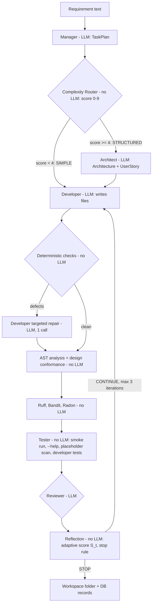
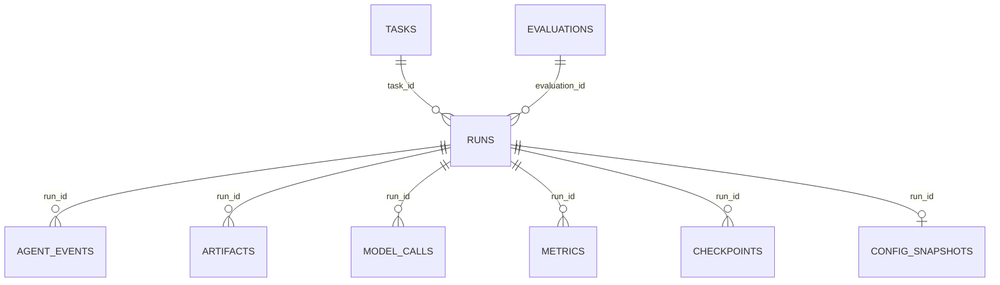

# MAS system guide and audit (22 Nov 2026)

How our multi-agent system works, from one requirement to a finished project, and what an
end-to-end audit of real generated code found. Every number here comes from the recorded
runs (series v2, model `gemini-3.5-flash-lite`) or from tests run on 22 Nov 2026.

---

## 1. What happens when MAS gets a requirement

One SRDD requirement (plus the shared CLI rule "must run with `python main.py` and exit 0
with `--help`") goes in. A folder of Python files comes out. In between, seven roles take
turns. Only four of them call the LLM.



**A real run, step by step** (`mas_srdd_work_01_r1_attempt2`, "Code Complexity Visualization"):

| Time | Step | LLM? | What happened |
|---|---|---|---|
| 21:45:39 | Manager | yes (1 call) | Normalised the requirement, wrote the acceptance criteria |
| 21:45:41 | Router | no | Score 4, so STRUCTURED |
| 21:45:41 | Architect | yes (2 calls) | Planned 3 files (`analyzer.py`, `reporter.py`, `main.py`) and a class diagram |
| 21:45:44 | Developer, iteration 1 | yes (2 calls) | First answer unparseable, retry succeeded, wrote 4 files |
| 21:46:02 | Deterministic check | no | 3 defects: an empty `pass` function, and others |
| 21:46:02 | Targeted repair | yes (1 call) | Fixed `analyzer.py` |
| 21:46:05 | AST + conformance | no | 4 modules, 0 import cycles, design conformance 0.50 |
| 21:46:05 | Tester | no | 6 of 7 checks passed |
| 21:46:06 | Reviewer | yes (1 call) | FAILED: 1 critical, 1 major |
| 21:46:08 | Reflection | no | S_t = 0.849, CONTINUE |
| 21:46:08 | Iteration 2 | yes (2 calls) | Tester 7/8, Reviewer NEEDS_REVISION (a unit test expects the wrong line count) |
| 21:46:20 | Iteration 3 | yes (2 calls) | Tester 6/7, still NEEDS_REVISION |
| 21:46:30 | Reflection | no | STOP: max 3 iterations reached |

Totals: 11 LLM calls, 38,414 tokens, 51 seconds. Final scores from the frozen evaluator:
Completeness 1.0, Executability 1.0, Consistency 0.509, Quality 0.509.

---

## 2. Architecture

| Layer | Folder | What it holds |
|---|---|---|
| Agents | `mas/agents/` | `manager.py`, `router.py`, `architect.py`, `developer.py`, `tester.py`, `reviewer.py`, `reflection.py`, and `base.py` (the shared retry policy) |
| Orchestration | `mas/core/workflow.py` | `MASWorkflow.run()`: the loop in the diagram above |
| Core services | `mas/core/` | `llm.py` (provider client, token logger), `governor.py` (quota and rate limits), `proxy.py` (logging proxy used by ChatDev), `schemas.py` (artifact types), `validator.py`, `checkpoints.py`, `context.py` (slicer), `events.py`, `change_request.py` |
| Deterministic analysis | `mas/analysis/` | `ast_analyzer.py`, `conformance.py`, `deterministic_checker.py`, `quality_tools.py` (Ruff, Bandit, Radon), `sandbox.py` (Docker or isolated subprocess) |
| Baselines | `mas/baselines/single_agent.py`, `external/ChatDev` | One-call baseline; pinned ChatDev |
| Evaluation | `eval/` | `runner.py` (benchmark driver), `neutral_evaluator.py` + `scorers/` (frozen paper metrics), `stats.py`, `telemetry.py`, `reports.py` |
| Database | `mas/db/` | SQLAlchemy models, SQLite file `mas.db` |
| Interfaces | `mas/cli/`, `mas/api/`, `frontend/` | CLI, FastAPI REST + WebSocket, React UI |
| Reporting | `scripts/make_report.py`, `scripts/make_dashboard.py` | Thesis tables (Markdown, LaTeX), HTML dashboard |

**Agents communicate through typed artifacts**, never free text. Each artifact is a Pydantic
model in `mas/core/schemas.py`, validated before the next agent may use it.

| Agent | Reads | Produces | LLM calls |
|---|---|---|---|
| Manager | requirement | `TaskPlan` (description, files, sprint goals, acceptance criteria) | 1 |
| Router | requirement | SIMPLE or STRUCTURED | 0 |
| Architect | TaskPlan | `Architecture` (components, class diagram, file structure, dependencies) and `UserStory` ("As a role, I want action, so that goal" plus criteria) | 2, STRUCTURED only |
| Developer | plan, design file list, review findings, test failures | `CodePatch` (files written to the workspace) | 1 per iteration, plus 1 repair if checks fail |
| Tester | workspace | `TestReport` (checks passed and failed, real error text) | 0 |
| Reviewer | code, test report, AST, Ruff, Bandit, conformance | `ReviewReport` (status, critical, major, minor, findings) | 1 per iteration; skipped once a review has passed and the code is still clean |
| Reflection | all the reports | `ReflectionDecision` (STOP or CONTINUE, S_t, gain) | 0 |

A clean SIMPLE task costs 3 LLM calls (Manager, Developer, Reviewer). Our 5 tasks averaged
7.2 calls and 22,792 tokens.

---

## 3. Algorithms

**3.1 Complexity router** (`mas/agents/router.py`, no LLM). The score is computed from:
- **Feature categories:** +1 each for persistence, authentication, multiple roles,
  external integrations, analytics and workflow state. Each category is one regex.
- **Separators:** +1 for 4 or more commas, "and", semicolons or bullets; +2 for 7 or more.
- **Length:** +1 if the requirement has more than 80 words.

A score of 4 or more means STRUCTURED, which adds the Architect. This is our version of
iCoder's complexity-driven decomposition (paper Sec. 3.3.3), simplified to two levels.

**3.2 Artifact production policy** (`mas/agents/base.py`):
1. Save a checkpoint.
2. Generate.
3. If schema validation fails, retry once with the error message as feedback.
4. If that fails, roll back to the checkpoint and retry with the full JSON schema.
5. If that fails, the run fails. ReviewReport is the exception: it falls back to a safe
   "NEEDS_REVISION" report.

At most 3 attempts per artifact; provider and budget errors are never retried here.

**3.3 Delimiter parsing** (`parse_delimiter_blocks`). Files arrive as
`=== FILE: name ===` … `=== END FILE ===` blocks, which are more robust than JSON for a small
model because code needs no escaping. If that fails, the parser falls back to JSON, then to
markdown code blocks with file names, then to a single code block.

**3.4 Deterministic checks and targeted repair** (`deterministic_checker.py`):
- **Checks:** `main.py` exists; every file parses (AST); placeholder scan; smoke run.
- **Placeholder rule:** a function whose body is `pass`, `...`, only a docstring, or raises
  `NotImplementedError`, or that contains a `TODO`/`FIXME` comment, counts as unimplemented.
  This is the paper's ReviewBot rule (Sec. 3.2.4).
- **Repair:** if a check fails, the Developer gets one repair call with only the failing
  files and the error text.

**3.5 Tester** (`mas/agents/tester.py`, no LLM). Builds the TestReport from four real
observations:
1. The entry-point smoke protocol.
2. Whether `python main.py --help` exits with 0.
3. The placeholder scan.
4. The Developer's own `test_*.py` files, run by a small built-in runner (functions named
   `test*` and `unittest.TestCase` classes), because the sandbox image has no pytest.

`pass_rate` = passed checks / total checks. `coverage` is not measured and stays 0.

**3.6 AST dependency graph and cycles** (`ast_analyzer.py`, our version of iCoder's R-DCGG):
- **Graph:** files are nodes; local `import` and `from … import` statements are edges.
- **Cycle detection:** three-colour depth-first search (white, grey, black). An edge back
  to a grey node is a cycle, recorded as the stack slice from that node.

**3.7 Impact set** (`compute_impact_set`). Reverse every edge, then breadth-first search from
the changed modules. The result is every module that depends on a change, directly or
indirectly. It chooses which files the Developer sees in later iterations (since v3; see P1).

**3.8 Design conformance** (`mas/analysis/conformance.py`, iCoder's reverse-UML validation, no LLM):
- **Forward model:** the Architect's planned files, classes in the class diagram, and
  module dependencies.
- **Reverse model:** the files, classes and local imports found in the code.
- **Score:** `1 − (missing files + missing classes) / (planned files + planned classes)`.

**3.9 Adaptive stopping** (`reflection.py`). Each iteration gets a score:

```
S_t = 0.30·test + 0.10·ruff + 0.15·bandit + 0.10·radon + 0.15·reviewer + 0.20·CE
```

The six terms (weights sum to 1.0):

| Term | Formula |
|---|---|
| test | Tester pass rate |
| ruff | `1 − min(violations/10, 1)` |
| bandit | `1 − min((3·high + 2·medium + low)/10, 1)` |
| radon | maintainability index / 100 |
| reviewer | `1 − min((3·critical + major)/6, 1)` |
| CE | (internal completeness + executability) / 2 |

The loop stops at the first of these that holds:

| Rule | Condition |
|---|---|
| Clean result | no critical defect and every check passed |
| Plateau | gain `S_t − S_{t−1}` below 0.02 for 2 iterations in a row |
| Limit | iteration 3 reached |

This is a formal version of the paper's two-stage review-then-test control, eq. (1)-(2).

**3.10 Quota and budget control** (`governor.py`, `llm.py`):
- **Sliding-window rate limiter:** 12 requests and 200,000 tokens per rolling 60 seconds.
- **Daily cap:** 450 requests (500 minus a 10% margin), resetting at midnight
  America/Los_Angeles.
- **Two-phase ledger:** each request reserves a slot before it is sent and is finalised
  after, guarded by an inter-process file lock.
- **Per-run token budget:** 100,000 tokens. Each call reserves its estimated tokens before
  dispatch and is refused if they don't fit.

**3.11 Evaluation metrics** (frozen, `eval/scorers/icoder_metrics.py`, the paper's Sec. 4.3):

| Metric | How it is computed |
|---|---|
| Completeness | 1 − unimplemented functions / all functions (placeholder rule as in 3.4) |
| Executability | 1 if the smoke protocol passes, else 0. Protocol: import and call `main()` headlessly (Tk windows stubbed); if it exits with a usage error, `--help` must exit 0 and a run with a temporary file argument must not crash |
| Consistency | Cosine similarity of `all-MiniLM-L6-v2` embeddings (384 dimensions) of the requirement and the first 2,000 characters of code, clipped to [0, 1] |
| Quality | Completeness × Executability × Consistency, averaged over projects |

Statistics (`eval/stats.py`): bootstrap 95% confidence intervals (10,000 resamples, seed 42),
paired Wilcoxon signed-rank test, Cohen's d. The official row for each task, system, repeat,
ablation, model and series is the first attempt that wasn't an infrastructure error.
Quality failures stay in and count as 0.

---

## 4. Database model (`mas.db`, SQLite via SQLAlchemy)



| Table | Rows now | One row is | Key columns |
|---|---|---|---|
| `tasks` | 20 | one benchmark task | task_id, category, name, description |
| `evaluations` | 42 | one benchmark batch | evaluation_id, benchmark, repeat_no, ablation |
| `runs` | 94 | one system run on one task | run_id, task_id, system (mas/chatdev/single), model, actual_model, status, execution_mode, input/output/total tokens, token_provenance, workspace_path, artifacts_manifest (file hashes), started/finished |
| `agent_events` | 1,128 | one step in a run (append-only log) | seq, run_id, agent, event, status, redacted_summary, created_at |
| `artifacts` | 251 | one versioned agent output | run_id, type (TaskPlan, Architecture, UserStory, CodePatch, TestReport, ReviewReport, ReflectionDecision), version (= iteration), schema_valid, json_data |
| `model_calls` | 658 | one LLM call | run_id, agent, requested_model, actual_model, input/output/total tokens, latency_ms, cost, raw provider metadata |
| `metrics` | 776 | one score | run_id, metric_name, metric_value, scope (`internal` = MAS's own signals, `neutral` = frozen evaluator) |
| `checkpoints` | 0 | a workspace snapshot | run_id, iteration, git_ref (unused: snapshots go to `.mas_snapshots/` on disk) |
| `config_snapshots` | 0 | config and library versions per run | run_id, config_json, library_versions (defined but never written) |

Outside the database:

| File | Holds |
|---|---|
| `eval/benchmark_manifest.json` | Every benchmark run record, with official flags, series, per-agent breakdown and failure classification |
| `results.csv` | The same records as a table |
| `eval/outbound_transmission_ledger.json` | Daily request ledger |
| `eval/workspaces/<run_id>/` | Generated code |

---

## 5. Where the generated code is and how to run it

Benchmark runs write to `eval/workspaces/<run_id>/`. For example:
- `eval/workspaces/mas_srdd_educ_02_r1_attempt3/`: Bookshelf Manager (`main.py`, `test_main.py`)
- `eval/workspaces/mas_srdd_work_01_r1_attempt2/`: Code Complexity Visualization (`main.py`, `analyzer.py`, `reporter.py`, `test_main.py`)

Runs started from the CLI, API or frontend go to `workspace/<run_id>/`. The
`.mas_snapshots/` folder inside each one holds the checkpoints.

Run a generated project:

```powershell
cd "eval\workspaces\mas_srdd_educ_02_r1_attempt3"
python main.py --help
python main.py
python -m unittest test_main
```

Run MAS on your own requirement. The CLI's default model is still the old OpenRouter
alias, so pass the model explicitly:

```powershell
python mas_cli.py run --task "A to-do list app where users add, complete and delete tasks" --model gemini-3.5-flash-lite
python mas_cli.py logs <run_id>
python mas_cli.py results <run_id>
```

---

## 6. Audit of the generated code (MAS, series v2, 5 tasks)

**Syntax:** all 28 Python files in the 10 generated projects (5 MAS, 5 single-agent) parse
without errors.

**Developer-written tests:** 4 of 5 MAS projects pass their own tests (2, 5, 4 and 8 tests).
In Code Complexity Visualization 1 of 4 tests fails, because the test itself is wrong: it
expects 9 lines for an 8-line string.

**User-flow tests.** Each program was copied to a scratch folder and driven through its
main journey with scripted input, plus bad input and a restart to check saved data.

| Project | Journey tested | Result | Bugs found |
|---|---|---|---|
| Bookshelf Manager | add 3 books on shelves, view, search by author, filter by shelf, edit, delete, report, restart | **Pass.** All features work; data persists in `book_collection.json`; a bad ID gets "Invalid ID." | Rating 9 silently stored as 0; "filter" is shelf only |
| BookLift | recommendations without a profile, create profile, add genres, duplicate genre, rate (valid and invalid), recommendations, book details, collections, restart | **Pass with 2 bugs** | (1) creating a user also saves a junk profile literally named `"username"` (line 112); (2) the collection menu order changes every run (built from a `set`), so "collection 2" means a different thing each time; ratings never influence recommendations |
| Culture Reflection | guided prompt, invalid prompt, empty reflection, free-form entry, list, restart | **Pass** | none found |
| Language Conversation Partner | French session, guide, short message, exit; Japanese topics | **Runs, but mostly simulated** | the "native speaker" is a random canned reply (in Spanish even for French); feedback is a keyword check ("Je suis etudiant" gets "looks good"); voice chat is only a label; **crashes with `UnicodeEncodeError` for `--language Japanese` on a normal Windows console** |
| Code Complexity Visualization | built-in sample, a 371-line real file, a syntax-error file, a missing file | **Partial** | a syntax-error file gets "complexity within acceptable limits"; one number per file, not per function; the "interactive" HTML report has no interactivity, so zoom and navigation are missing |

**Does the generated code match the dataset prompts?** Mostly, at the level of an
interactive command-line program:
- Every project implements the core nouns and verbs of its requirement.
- The gaps are features that need a GUI, a network or real language processing (zoom and
  navigate, connect people, voice chat, pronunciation feedback). Those get simulated or
  skipped.
- The Consistency metric (about 0.50) can't see these gaps; only functional testing like
  the above can.

**Blind spot in our own evaluator:** the smoke protocol forces UTF-8 output, so the
Japanese crash above scored Executability 1.0.

---

## 7. Problems found in MAS itself (prioritised)

| # | Problem | Evidence | Fix (no extra LLM calls) |
|---|---|---|---|
| P1 | **Fixed (DEC-045, series v3).** ~~The Developer never sees its previous code.~~ The workflow computes the sliced context every iteration and throws it away: `developer.py:220` assigns `uml_slice` and never uses it, and the sliced files never reach a prompt. Iterations 2-3 rewrite the whole project blind. | Test expectation flipped 10 → 9; regressions between iterations; 3.3k-4.8k output tokens per rewrite; ablation A2 changes nothing the model sees | Put the sliced files and UML into the Developer prompt from iteration 2; ask for changed files only (unchanged files are kept) |
| P2 | **Fixed (DEC-045).** ~~The class diagram never reaches the Developer~~ | Design conformance stuck at 0.50 (`Analyzer` planned, `CodeAnalyzer` built) | Include the class diagram in the Developer prompt on the STRUCTURED path |
| P3 | **Fixed (DEC-045).** ~~The last iteration ships, not the best~~ | work_01: S_t 0.9375 at iteration 2, 0.9321 at iteration 3; iteration 3 shipped | Restore the checkpoint with the highest S_t when the loop ends |
| P4 | **Fixed (DEC-045).** ~~Loop gets stuck on wrong self-written tests~~ | 2 of 3 iterations on work_01 spent on a test bug | When only developer tests fail, tell the Developer it may fix a wrong test expectation, and prioritise requirement findings |
| P5 | Executability check forces UTF-8 | Japanese crash scored as runnable | Also smoke-test with the platform's default encoding (needs a frozen-evaluator decision) |
| P6 | `checkpoints` and `config_snapshots` tables are never written | 0 rows each | Write them, for reproducibility |
| P7 | CLI defaults to `openrouter/free`; CLI `evaluate` is stale (`gpt-4o`, mas/chatdev only) | `mas/cli/main.py:31,57` | Default to `BENCH_MODEL`; point `evaluate` at `eval.runner` |
| P8 | Duplicate API route `GET /runs/{run_id}/workspace` | `mas/api/routes.py:343` and `:504` | Remove the dead second definition |

P1-P4 are fixed in series v3 (DEC-045). v2 results were produced before the fixes and are
kept separate; v3 needs its own benchmark run.

---

## 8. Questions you are likely to be asked

- **Why seven agents, if only four call the LLM?** Routing, testing, reflection and the
  structural analysis are deterministic, so they are free, repeatable and can't make
  things up. LLM calls go only where language understanding is needed. That's how the free
  tier (500 requests a day) stays workable.
- **How is this different from ChatDev?** ChatDev is a role-play chat between agents, about
  15 calls per task here. MAS uses typed artifacts, real execution feedback and an adaptive
  stopping rule: 7.2 calls and 23k tokens per task, against 15.8 calls and 52k tokens for
  ChatDev.
- **How is it different from iCoder?** Same four ideas (decomposition, design, development,
  review loop). We add a deterministic router, a tool-based tester, evidence-grounded
  review and adaptive stopping. We simplify sprints to one per run and UML to one text
  class diagram.
- **Can the LLM inflate its own scores?** No. The Tester, Reflection and the evaluator use
  real execution and AST checks. The frozen evaluator is never edited during the benchmark,
  and the requirement text is never copied into code.
- **What does Consistency measure, and what not?** Embedding similarity between requirement
  and code. It rewards related vocabulary, not working features. That's why the user-flow
  tests in section 6 matter.
- **Are the results significant?** Not yet. With 5 tasks, MAS vs ChatDev gives Wilcoxon
  p = 0.125. More tasks are needed.
- **What is the main weakness?** Until v3, the loop didn't give the Developer its own code,
  so later iterations rewrote instead of refining (P1, fixed in DEC-045). Remaining:
  features that need a GUI, network or real language processing are simulated, and
  Consistency can't detect that.
