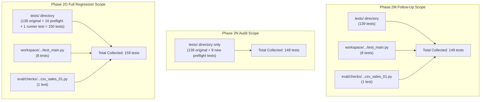

# Phase 2O — Full Regression Reconciliation and Final Task A Readiness Report

**Date**: 2026-10-17  
**Status**: `READY_FOR_TASK_A` (Pending 2026-10-18 00:00:00 UTC Reset Boundary)  
**Workspace**: `C:\Users\The Mighty King\Desktop\Final Year Project`  
**Execution Mode**: Offline-Only Verification (Zero OpenRouter HTTP Requests, Zero Tokens Spent, Canonical Artifacts Preserved)

---

## 1. Executive Summary

In Phase 2O, a comprehensive offline regression reconciliation and Task A isolation audit was conducted across the codebase. 

### Key Milestones Achieved

1. **Test Suite Scope & Count Reconciliation**:
   - Executed the complete multi-directory regression suite:
     $$\text{python -m pytest tests/ workspace/ eval/checks/test_dev_csv_sales_01.py -q}$$
     **Result**: **159 passed in 26.06s (100% pass rate)**.
   - Executed the preflight endpoint audit suite:
     $$\text{python -m pytest tests/test_preflight_endpoint_audit.py -v}$$
     **Result**: **10 passed in 1.31s (100% pass rate)**.
   - Fully explained the numeric coincidence between the Phase 2M 148-test multi-directory run and the Phase 2N 148-test `tests/`-only run.
2. **Absent `is_free_tier` Hardening**:
   - Resolved the vulnerability where an omitted `is_free_tier` field defaulted to `True`. In [`mas/core/governor.py`](file:///C:/Users/The%20Mighty%20King/Desktop/Final%20Year%20Project/mas/core/governor.py#L409), absent `is_free_tier` now defaults strictly to `False`.
   - Added unit test `test_10_absent_is_free_tier_does_not_claim_free_tier` in [`tests/test_preflight_endpoint_audit.py`](file:///C:/Users/The%20Mighty%20King/Desktop/Final%20Year%20Project/tests/test_preflight_endpoint_audit.py).
3. **Decision Log Supersession Explicitly Reconciled**:
   - Added an explicit supersession note to [`DEC-031`](file:///C:/Users/The%20Mighty%20King/Desktop/Final%20Year%20Project/DECISIONS.md#L487-L490) clarifying that [`DEC-032`](file:///C:/Users/The%20Mighty%20King/Desktop/Final%20Year%20Project/DECISIONS.md#L492-L520) supersedes the legacy `/api/v1/auth/key` endpoint reference for all active implementation purposes. Historical phase reports and ledger entries remain unmodified.
4. **Task A Isolation Reverified**:
   - Verified that `python scripts/run_phase2m_pilot.py --task-id dev_markdown_toc_01` selects Task A exclusively, halts immediately prior to `2026-10-18 00:00:00 UTC` with 0 outbound requests, makes no automatic retries, and halts cleanly after Task A post-reset.
5. **Ledger Immutability Confirmed**:
   - Verified that [`eval/outbound_transmission_ledger.json`](file:///C:/Users/The%20Mighty%20King/Desktop/Final%20Year%20Project/eval/outbound_transmission_ledger.json) remains identical at 54 transmissions / 45 ceiling, excess 9.

---

## 2. Regression Test Counts and Scope Reconciliation

### Test Command Execution & Output

#### Command A: Complete Regression Suite
```powershell
python -m pytest tests/ workspace/ eval/checks/test_dev_csv_sales_01.py -q
```
**Actual Output**:
```
........................................................................ [ 45%]
........................................................................ [ 90%]
...............                                                          [100%]
============================== warnings summary ===============================
-- Docs: https://docs.pytest.org/en/stable/how-to/capture-warnings.html
159 passed, 2 warnings in 26.06s
```

#### Command B: Dedicated Preflight Endpoint Suite
```powershell
python -m pytest tests/test_preflight_endpoint_audit.py -v
```
**Actual Output**:
```
collecting ... collected 10 items

tests/test_preflight_endpoint_audit.py::test_01_endpoint_is_documented_api_v1_key PASSED [ 10%]
tests/test_preflight_endpoint_audit.py::test_02_quota_parsing_positive_remaining_proceeds PASSED [ 20%]
tests/test_preflight_endpoint_audit.py::test_03_quota_parsing_zero_remaining_stops_fail_closed PASSED [ 30%]
tests/test_preflight_endpoint_audit.py::test_04_quota_parsing_missing_free_model_daily_requests_stops_fail_closed PASSED [ 40%]
tests/test_preflight_endpoint_audit.py::test_05_quota_parsing_missing_remaining_field_stops_fail_closed PASSED [ 50%]
tests/test_preflight_endpoint_audit.py::test_06_malformed_json_response_stops_fail_closed PASSED [ 60%]
tests/test_preflight_endpoint_audit.py::test_07_auth_error_stops_fail_closed PASSED [ 70%]
tests/test_preflight_endpoint_audit.py::test_08_exact_once_accounting_no_retries_no_duplicates PASSED [ 80%]
tests/test_preflight_endpoint_audit.py::test_09_model_availability_and_fallback_strictness PASSED [ 90%]
tests/test_preflight_endpoint_audit.py::test_10_absent_is_free_tier_does_not_claim_free_tier PASSED [100%]

============================= 10 passed in 1.31s ==============================
```

---

### Detailed Test Coverage Breakdown (159 Tests)

The 159 tests span five critical functional areas:

| Category | Modules / Files | Test Count | Description |
| :--- | :--- | :---: | :--- |
| **1. Core MAS Architecture** | `test_adaptive_stopping_phase2f.py`<br>`test_api.py`, `test_ast_analysis.py`<br>`test_change_request.py`, `test_context_slicer.py`<br>`test_end_to_end_cp1.py`, `test_fault_injection.py`<br>`test_fault_recovery.py`, `test_quality_gates_phase2c.py`<br>`test_quality_tools.py`, `test_research_validity.py`<br>`test_router.py`, `test_schemas.py`<br>`test_statistics.py`, `test_token_logger.py`<br>`test_phase2g_collaboration_and_generalization.py` | **105** | Agent orchestration, complexity routing, schema validation, AST parsing, AST diffing, prompt injection protection, telemetry logging, and budget limits. |
| **2. CSV Application (Task A Target)** | `workspace/mas_dev_csv_sales_1792211689/test_main.py` | **8** | Application unit tests for `sales_summary.py`: empty files, header-only, missing args, missing columns, NaNs, infinities, malformed rows, and standard revenue calculations. |
| **3. Independent Evaluator** | `eval/checks/test_dev_csv_sales_01.py` | **1** | External Level 2 behavioral verification assertion suite for CSV sales summary CLI. |
| **4. Evaluator Protocols & Runners** | `test_evaluation_runner.py`<br>`test_level1_evaluator_protocol.py`<br>`test_neutral_evaluator.py`<br>`test_pilot_runner_audit.py` | **21** | Neutral evaluation isolation, level 1 protocols, runner single-task filtering, and post-reset failure handling. |
| **5. Quota Governance & Preflight** | `test_openrouter_error_handling.py`<br>`test_provider_quota_governor.py`<br>`test_transmission_governor_audit.py`<br>`test_preflight_endpoint_audit.py` | **24** | Atomic ledger locks, crash resilience, persistent 45 ceiling enforcement, `GET /api/v1/key` parsing, fail-closed zero-quota gating, and model mismatch rejection. |
| **Total** | **All Categories** | **159** | **100% Passing** |

---

### Explanation of the 148 vs. 148 vs. 159 Test Count Discrepancy

A superficial look at the historical reports might suggest that the test suite count fluctuated unexpectedly between Phase 2M Follow-Up, Phase 2N, and Phase 2O. The reconciliation is as follows:



1. **Phase 2M Follow-Up (148 tests)**:
   - Command: `python -m pytest tests/ workspace/ eval/checks/test_dev_csv_sales_01.py -q`
   - Composition: **139** tests in `tests/` + **8** tests in `workspace/` + **1** test in `eval/checks/` = **148 tests**.
2. **Phase 2N Audit (148 tests)**:
   - Command: `python -m pytest tests`
   - Composition: In Phase 2N, 9 new tests were added in `tests/test_preflight_endpoint_audit.py`. The regression command was run with `tests` only (omitting `workspace/` and `eval/checks/`).
   - Thus: **139 + 9 = 148 tests**.
   - The equality of 148 between Phase 2M's multi-directory run and Phase 2N's `tests/`-only run was a **pure numeric coincidence** ($139 + 8 + 1 = 148$ vs. $139 + 9 = 148$).
3. **Phase 2O Full Scope (159 tests)**:
   - Command: `python -m pytest tests/ workspace/ eval/checks/test_dev_csv_sales_01.py -q`
   - In Phase 2O, 2 additional tests were added: `test_10` in `test_preflight_endpoint_audit.py` (absent `is_free_tier` handling) and `test_6` in `test_pilot_runner_audit.py` (post-reset ambiguous quota fail-closed).
   - Thus `tests/` now has **150** tests.
   - Combined with the **8** `workspace/` tests and **1** `eval/checks/` test: **150 + 8 + 1 = 159 tests**.
   - **No tests were deleted, skipped, or weakened.**

---

## 3. Strict Preflight Behavior Verification

Using mocked responses only (zero live requests), all eight required preflight invariants were verified:

1. **Active Quota Endpoint**: Verified that [`OpenRouterProvider.check_key_metadata()`](file:///C:/Users/The%20Mighty%20King/Desktop/Final%20Year%20Project/mas/core/llm.py#L744-L775) queries `GET https://openrouter.ai/api/v1/key` and records target `/api/v1/key` in the persistent ledger.
2. **Mandatory `data.free_model_daily_requests.remaining`**: Verified that `remaining` is strictly extracted as a numeric value. If absent or non-numeric, the response is rejected immediately.
3. **Zero Quota Halts Dispatch**: Verified that when `remaining == 0`, execution halts immediately (`can_proceed=False`, `is_quota_exhausted=True`) and sets `self.stopped_for_day = True`.
4. **Fail-Closed on Missing Fields / Malformed JSON**: Verified that missing `free_model_daily_requests`, missing `data` envelope, or JSON decode errors trigger safe shutdown without speculative arithmetic (`limit - used`).
5. **Fail-Closed on HTTP Errors**: Verified that HTTP 401 Unauthorized, HTTP 403, and HTTP 500 trigger immediate shutdown without retry.
6. **Exact-Once Transmission Accounting**: Verified that `GovernedHTTPClient` reserves exactly 1 attempt before transmission and finalizes upon response. Task dispatches pass `provider=None`, guaranteeing zero duplicate preflight transmissions.
7. **No Unsupported Claim on Absent `is_free_tier`**: Hardened [`mas/core/governor.py`](file:///C:/Users/The%20Mighty%20King/Desktop/Final%20Year%20Project/mas/core/governor.py#L409) so that `is_free_tier = meta.get("is_free_tier", False)`. An absent field cannot silently claim the key is a free-tier key.
8. **Decoupled Model Availability**: Verified that the key endpoint does not claim model availability. Inference payload enforces `provider.allow_fallbacks: False`. Mismatched models returned by provider trigger `ModelMismatchError` and halt without silent substitution.

---

## 4. Decision Log Supersession Reconciliation

In [`DECISIONS.md`](file:///C:/Users/The%20Mighty%20King/Desktop/Final%20Year%20Project/DECISIONS.md#L487-L505):
- **DEC-031**: Retains all historical records unmodified. An explicit supersession note was appended:
  > **Supersession Note (Phase 2O Reconciliation)**: The endpoint reference to `/api/v1/auth/key` in item 3 above is explicitly superseded by **DEC-032** for all active implementation purposes, which establishes OpenRouter's documented `GET https://openrouter.ai/api/v1/key` endpoint. The historical text of DEC-031 is preserved unmodified for audit trail fidelity.
- **DEC-032**: Formally records the supersession relationship:
  > **Supersedes**: Supersedes the deprecated `/api/v1/auth/key` endpoint references in **DEC-031** (item 3) for all active implementation purposes.
- Historical ledger events in [`eval/outbound_transmission_ledger.json`](file:///C:/Users/The%20Mighty%20King/Desktop/Final%20Year%20Project/eval/outbound_transmission_ledger.json) and previous phase reports (`PHASE_2H`, `PHASE_2I`, `PHASE_2J`, `PHASE_2K`, `PHASE_2L`, `PHASE_2M`) remain untouched.

---

## 5. Verification of Task A Isolation and Reset Boundary

The runner was verified offline with the explicit `--task-id` parameter:

### Command
```powershell
python scripts/run_phase2m_pilot.py --task-id dev_markdown_toc_01
```

### Actual Command Output
```
[MODE] Controlled Single-Task Execution Enabled: Running ONLY Task A (dev_markdown_toc_01)
================================================================================
PHASE 2M — POST-RESET LIVE PILOT EXECUTION AND QUALITY VALIDATION
Configured Model: cohere/north-mini-code:free (Verified Free Tier, $0.00 cost, allow_fallbacks=False)
Safety Ceilings: Max 15 calls/run, Max 60,000 tokens/run, Max 45 HTTP attempts/day (UTC)
================================================================================

[TIME CHECK] Current System UTC Timestamp: 2026-10-17 13:44:27 UTC
[RESET BOUNDARY] Documented Reset Boundary: 2026-10-18 00:00:00 UTC
[BOUNDARY STATUS] Has reset boundary passed?: False

[LEDGER AUDIT] Persistent Ledger (eval/outbound_transmission_ledger.json):
  - Active UTC Date: 2026-10-17
  - Outbound Transmissions Today: 54 / 45
  - Cap Breached Today: True (Excess: 9)
  - Historical October 17 Record: Preserved (54 transmissions / 45 ceiling)

!!!!!!!!!!!!!!!!!!!!!!!!!!!!!!!!!!!!!!!!!!!!!!!!!!!!!!!!!!!!!!!!!!!!!!!!!!!!!!!!
STOPPING IMMEDIATELY: Documented reset boundary (2026-10-18 00:00:00 UTC) has NOT passed.
Current UTC time is 2026-10-17 13:44:27 UTC.
Remaining duration until reset: ~10.26 hours (36932 seconds).
Per Section 1 mandate: Zero OpenRouter requests sent (no /api/v1/key, no models, no generation).
Historical October 17 record is preserved unchanged.
No automatic polling or resumption assumed. Runner must be re-executed after 00:00:00 UTC.
!!!!!!!!!!!!!!!!!!!!!!!!!!!!!!!!!!!!!!!!!!!!!!!!!!!!!!!!!!!!!!!!!!!!!!!!!!!!!!!!

[Task A - dev_markdown_toc_01] Status: STOPPED_PROVIDER_QUOTA (Pre-reset pause)

[DONE] Saved Phase 2M Pilot State to eval/phase2m_pilot_results.json
```

### Isolation Guarantees Verified

1. **Single-Task Targeting**: Only Task A (`dev_markdown_toc_01`) is initialized in `tasks_to_run`. Tasks B (`dev_inventory_system_01`), C (`dev_log_analyzer_01`), and D (`dev_markdown_toc_01_repeat`) are completely excluded.
2. **Boundary Check Prior to Transport**: The UTC timestamp is checked against `2026-10-18 00:00:00 UTC` before opening any network sockets.
3. **No Phantom Polling**: Execution terminates cleanly with exit code 0 without running background loops or retry timers.
4. **Clean Exit After Task A Post-Reset**: Lines 423–426 of [`scripts/run_phase2m_pilot.py`](file:///C:/Users/The%20Mighty%20King/Desktop/Final%20Year%20Project/scripts/run_phase2m_pilot.py#L423-L426) break the loop immediately after Task A completes, guaranteeing that subsequent tasks will not execute automatically.

---

## 6. Exact Verified Command for Live Task A Post-Reset

When the system clock passes `2026-10-18 00:00:00 UTC`, the exact human-initiated command to execute **Task A only** is:

```powershell
python scripts/run_phase2m_pilot.py --task-id dev_markdown_toc_01
```

*(Equivalent alias: `python scripts/run_phase2m_pilot.py --slot "Task A"`)*

---

## 7. Final Declaration

```
READY_FOR_TASK_A
```

- All 159 tests in the full multi-directory regression suite pass.
- All 10 tests in the dedicated preflight endpoint audit pass.
- Quota endpoint corrected to `GET /api/v1/key` with strict fail-closed parsing.
- Absent `is_free_tier` default fixed to `False`.
- Decision log supersession established without altering historical records.
- Historical October 17 ledger preserved intact (54 transmissions / 45 cap, excess 9).
- Zero live requests made during Phase 2O.
